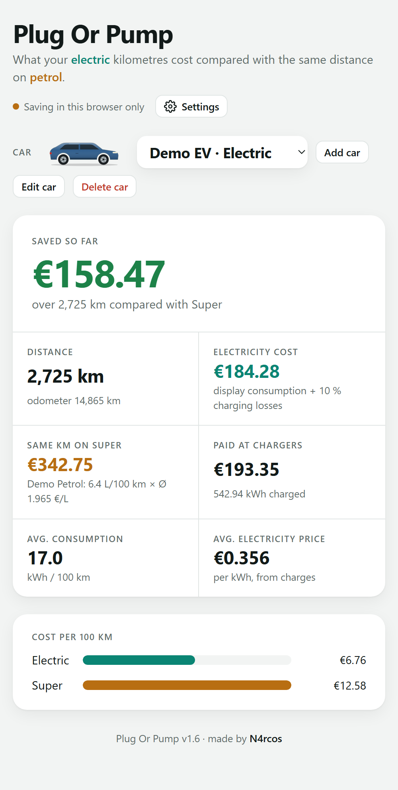
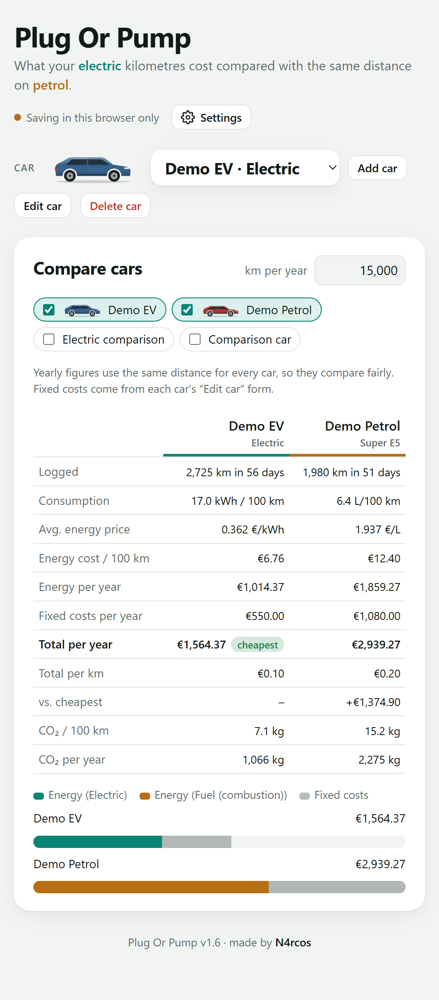
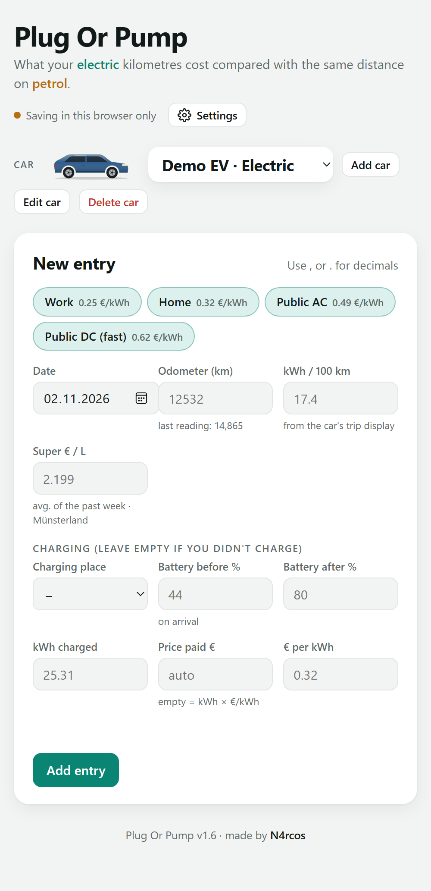
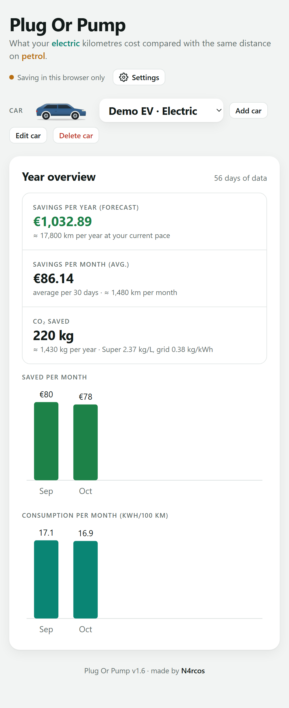
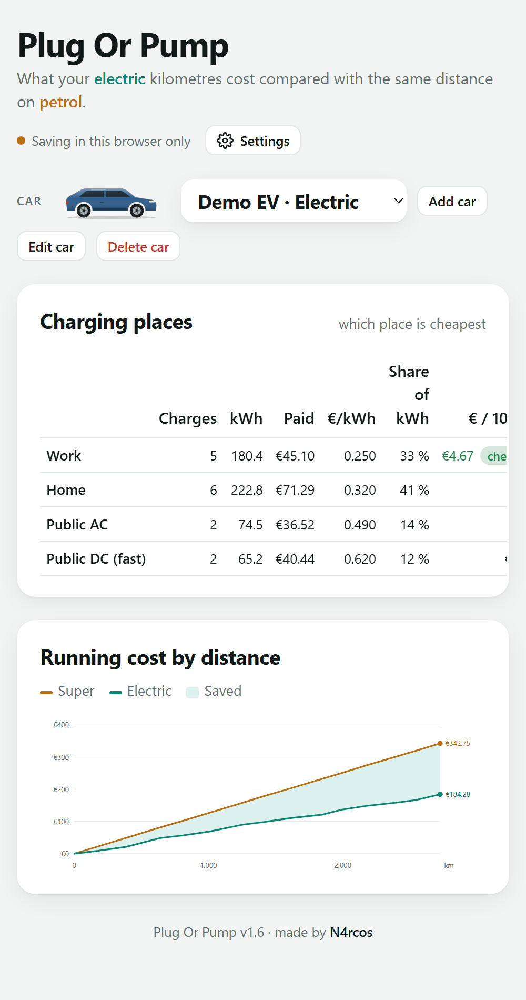
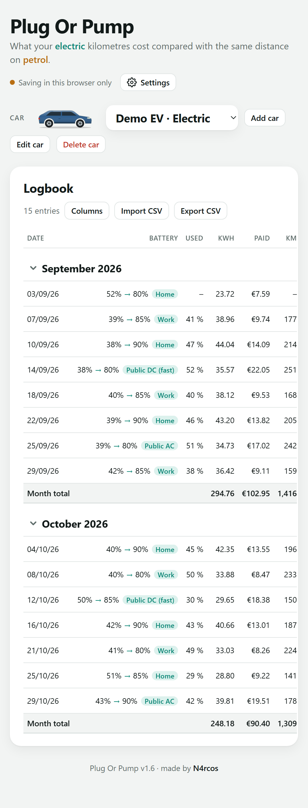
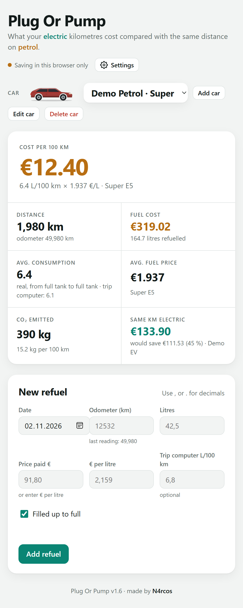
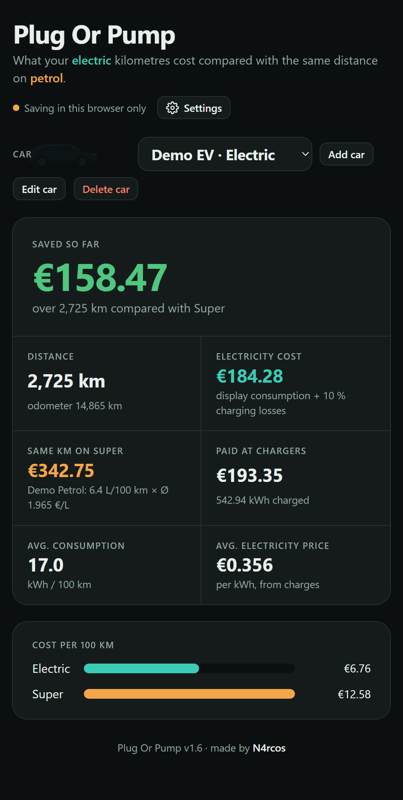

<p align="center"></p>

<h1 align="center">Plug Or Pump</h1>

<p align="center">What your electric kilometres cost, next to the same distance on petrol.</p>

<p align="center"><a href="https://n4rcosz.github.io/plug-or-pump/"><b>Open the app</b></a></p>

You log your charges and refuels, and Plug Or Pump works out what the same trips would have cost in a fuel car. It shows how much you have saved so far, what a year is likely to cost, and which car comes out cheaper once insurance, tax and the purchase price are counted.

It is a single web page. It installs on a phone like an app, works offline, and keeps your data on your own device.

## Screenshots

<table>
<tr>
<td width="33%"></td>
<td width="33%"></td>
<td width="33%"></td>
</tr>
<tr>
<td>Savings so far, distance, what you paid at chargers and the average price per kWh.</td>
<td>Every car side by side over a year: energy, fixed costs, purchase or leasing, CO₂.</td>
<td>One tap on Home, Work or a public charger fills in the price for you.</td>
</tr>
<tr>
<td></td>
<td></td>
<td></td>
</tr>
<tr>
<td>A forecast for the year, savings per month and the CO₂ you avoided.</td>
<td>Running cost by distance, and which charging place is cheapest per 100 km.</td>
<td>A logbook grouped by month, with totals. Import and export as CSV.</td>
</tr>
<tr>
<td></td>
<td></td>
<td></td>
</tr>
<tr>
<td>Fuel cars get their own refuel log, with real consumption from full tank to full tank.</td>
<td>Light and dark mode, following the phone or set by hand.</td>
<td></td>
</tr>
</table>

The screenshots use made-up demo cars and entries.

## What it does

- Works out electricity cost per trip from the trip computer's kWh/100 km, or from the battery percentage you used, plus your charging losses.
- Compares each trip with a fuel car: a real one you log refuels for, or one you describe in the settings.
- Checks the battery: measured charging losses, usable capacity and an estimate of battery health.
- Keeps a price per charging place (home, work, public AC, public DC) and shows which one is cheapest.
- Counts the full yearly cost, including insurance, tax, servicing, the THG quota and purchase or leasing.
- Fetches today's fuel prices for a German region from Tankerkönig (needs a free API key).
- Shows charging stations near a place on a map from OpenStreetMap, with fast chargers marked.
- Speaks English, German and Russian; shows km and litres or miles and US gallons; and writes money in one of 12 currencies.
- Saves a full backup to a file and restores it on another device.

## Install it

On an iPhone, open the app link in Safari, tap Share, then Add to Home Screen. Opening the HTML file from the Files app does not work, because Files shows pages without running them.

On Android, open the link in Chrome, open the menu and tap Install app (or Add to home screen).

On a computer, any current browser opens it. Chrome and Edge also offer to install it as an app from the address bar.

After the first visit the app opens without an internet connection. The map, the automatic fuel prices and new versions need one.

## Your data

Everything you enter stays in the browser on that device. Nothing is sent to a server of this project, and there is no account or tracking. The app only contacts other services when you use a feature that needs them:

- OpenStreetMap (Nominatim and Overpass) for the place search and the charging map
- openstreetmap.de for the map tiles
- Tankerkönig for fuel prices, with your own key
- cdnjs for the map library, the first time you open the map

Each device keeps its own data. To move it, use Settings, then Data & backup, then Save backup, and load the file on the other device with Merge. Make a backup now and then, because a browser can clear a site's storage.

## Run your own copy

The app is the file `index.html`; nothing needs to be built. To host it yourself, put these files on any web server with HTTPS, for example GitHub Pages:

```
index.html      the app
manifest.json   name, icon and full-screen mode for the home screen
sw.js           offline support
icon-*.png      app icons (logo.svg is the source)
```

When you publish a new version, also change the name in the first line of `sw.js` that starts with `const CACHE`, so phones drop the old copy.

## Credits

Made by N4rcos. Map data © OpenStreetMap contributors. Fuel prices from MTS-K via Tankerkönig (CC BY 4.0).
